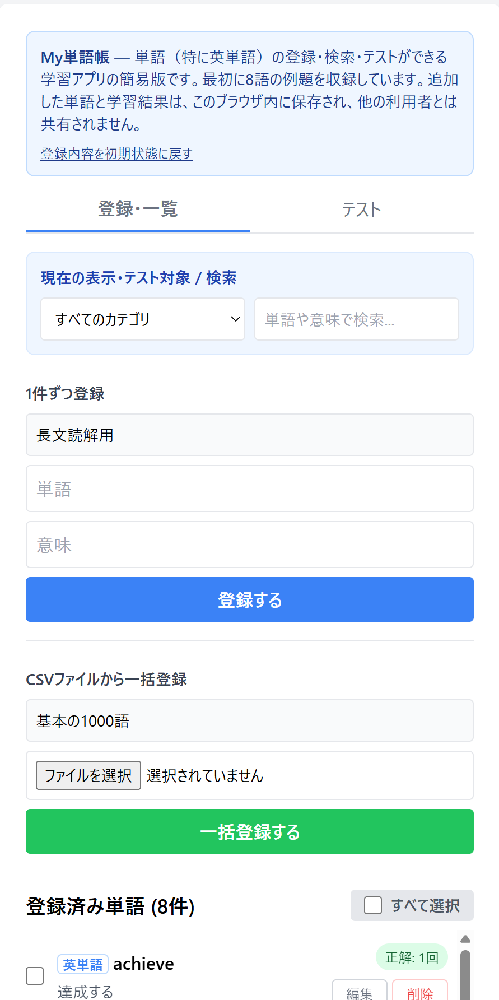
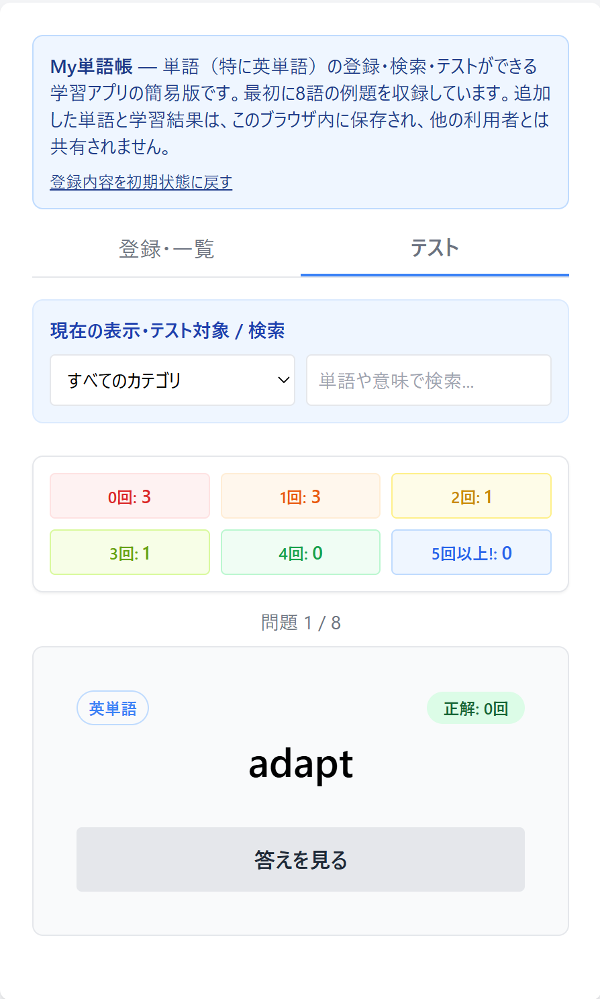

# My単語帳 — 単語学習Webアプリ（公開簡易版）

英単語を効率的に覚えるために制作したWebアプリ。単語の登録・分類・検索に加え、テスト形式で反復学習できる機能を備えている。

## アプリを試す

公開URL : 

※機能紹介のための**公開版**。初期状態では8単語を収録済み。追加・編集・削除した単語や学習記録は、閲覧者ごとのブラウザ内に保存され、他の利用者と共有されない。

## 主な機能（公開版）

- 英単語と意味の登録・編集・削除
- カテゴリ別表示、キーワード検索、アルファベット順の並べ替え
- CSV形式の一括登録
- テスト形式の学習と正解回数の記録
- 正解回数の少ない単語を優先してテストで出題
- 学習状況の集計表示
- スマートフォン・PCの両方に対応した画面

## 使い方

1. 英単語を登録する

「登録・一覧」画面で"カテゴリ"、"英単語"、"日本語の意味"を入力し、「登録する」を押すと単語を追加できる。
CSVファイルを使用すれば、複数の単語をまとめて登録可能。

2. 登録した単語を管理する

登録済みの単語は一覧から確認可能。
- カテゴリ別の絞り込みやキーワード検索
- 単語や意味の編集
- 不要な単語の削除
- チェックボックスを使った複数単語の一括削除

3. 英単語テストを行う

画面上部の「テスト」を選択すると、登録した単語から問題が出題される。テストの出題範囲はカテゴリを選択することで変更可能。
- 表示された英単語の意味を考える
- 「答えを見る」を押して正解を確認する
- 「正解！」または「間違えた」を選択する
正解した回数は自動的に記録され、正解回数の少ない単語から優先的に出題される。

4. 学習状況を確認する

テスト画面には、正解回数ごとの単語数が表示される。
習熟度を確認しながら、苦手な単語を重点的に学習しよう。

5. 例文を確認する

テストの解答画面では、登録済みの英語例文と日本語訳を確認できる。
個人用の完全版には、Geminiを活用して複数の英文と日本語訳を自動生成する機能も実装しているが、公開版ではAI生成機能の実行を省略している。

## 工夫点

使いやすさを重視した。カテゴリで範囲を絞ったり、検索したりできるほか、正解回数の少ない単語を優先して出題することで、苦手な単語を繰り返し復習できるようにした。CSVからの一括登録にも対応し、大量の単語を取り込みやすくした。

## アプリの構成について

この公開版は、HTMLとJavaScriptで動作する静的Webアプリです。個人利用している元のアプリでは、Python（FastAPI）によるバックエンド、SQLite / PostgreSQL（Neon）によるデータ管理、Gemini APIによる例文生成機能を使用している。

公開版では、私個人の学習データと分離するためデータ保存先をブラウザ内のlocalStorageに切り替えており、外部のデータベースやGemini APIへの接続は行わない。画面上の例文生成操作は、簡易的な例文を表示する方式である。

## アプリ画面

### 単語の登録・管理

単語の登録や検索、カテゴリ別の管理ができます。

### 英単語テスト

正解回数の少ない単語から優先的に出題し、苦手な単語を重点的に学習できます。

